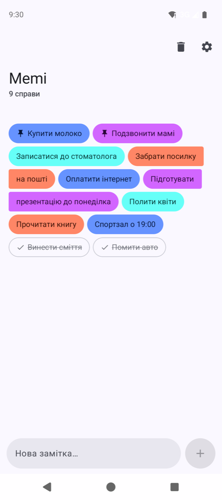
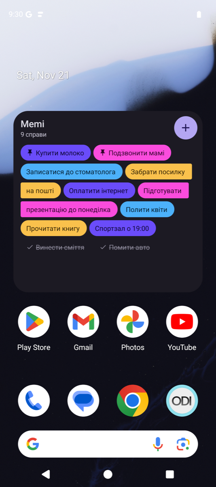
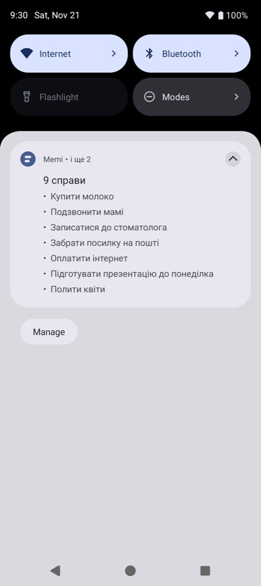
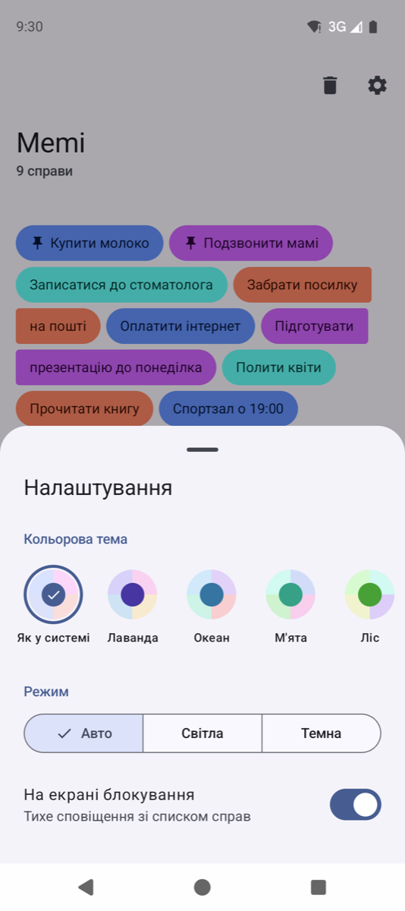
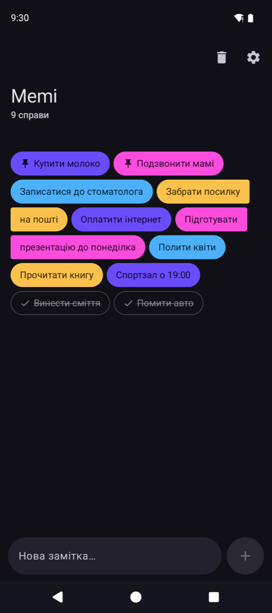

# Memi

**Tiny to-dos that are always in sight.**

Memi is a simple to-do app for Android. Type a short note, press enter, and it shows up as a colourful capsule. The capsules flow across the screen like words in a sentence. Your list is always one glance away: on the home screen, in the notification shade and on the lock screen. You don't have to open the app to see what's next.

<p align="center">
  
  &nbsp;
  
  &nbsp;
  
</p>

## Why Memi

- **Fast.** Type and press enter, with no titles, folders or due dates. A long note wraps neatly onto the next line.
- **Always visible.** The home-screen widget and the lock-screen notification keep your list in front of you all day.
- **Colourful and calm.** Each note gets a bright colour, and finished notes fade into a quiet outline.
- **Private.** Everything stays on your phone. There are no accounts and no ads, and nothing is sent anywhere.

## How to use it

| To… | Do this |
|---|---|
| Add a note | Type in the **Нова замітка…** field and tap **+**. You can also use the **+** on the widget or long-press the app icon. |
| Mark a note done (or undo it) | Tap it. |
| Rearrange, edit or delete | Long-press any note to enter arrange mode. Drag notes to reorder them, tap one to edit its text, colour or pin, or tap ✕ to delete it. If you delete by mistake, tap **Повернути** (undo). |
| Keep a note at the top | Pin it in the edit sheet. Pinned notes show a 📌. |
| Clear finished notes | Tap the 🗑 icon at the top. |

## Home-screen widget

Long-press an empty spot on your home screen and choose **Widgets → Memi**. Your list appears right on the home screen, and you can tap a note there to tick it off. The widget is resizable, so stretch it to fit as many notes as you like.

## On the lock screen

Memi can show your active notes as a silent notification. It never buzzes or makes a sound; it simply stays there, so you see your list every time you pick up your phone. You can turn it on or off under **Settings → На екрані блокування**.

## Make it yours

<p align="center">
  
  &nbsp;
  
</p>

Pick a colour theme. **Як у системі** follows your wallpaper colours on Android 12+, and there are also Lavender, Ocean, Mint, Forest and more. You can use light mode, dark mode or follow the system setting. The widget and the notification use the same look.

## Requirements

- Android 8.0 or newer
- The app is in Ukrainian 🇺🇦

## Install

There is no store listing yet, so you build the APK from source (see below) and install it on your phone.

---

## For developers

Memi is written in Kotlin with Jetpack Compose (Material 3), and the widget uses Glance. You need JDK 17 to build it.

```bash
./gradlew assembleDebug        # debug APK → app/build/outputs/apk/debug/
./gradlew installDebug         # install on a connected device/emulator
./gradlew testDebugUnitTest    # unit tests
./gradlew assembleRelease      # minified release build
```

To sign a release build, put `app/release.jks` in place and set `release.storePassword` in `local.properties` (gitignored). You can also set `release.keyPassword`, `release.keyAlias` and `release.storeFile`, or provide all of them as `RELEASE_*` environment variables. Without a key, the release APK is built unsigned.

For the architecture overview, see [CLAUDE.md](CLAUDE.md).
